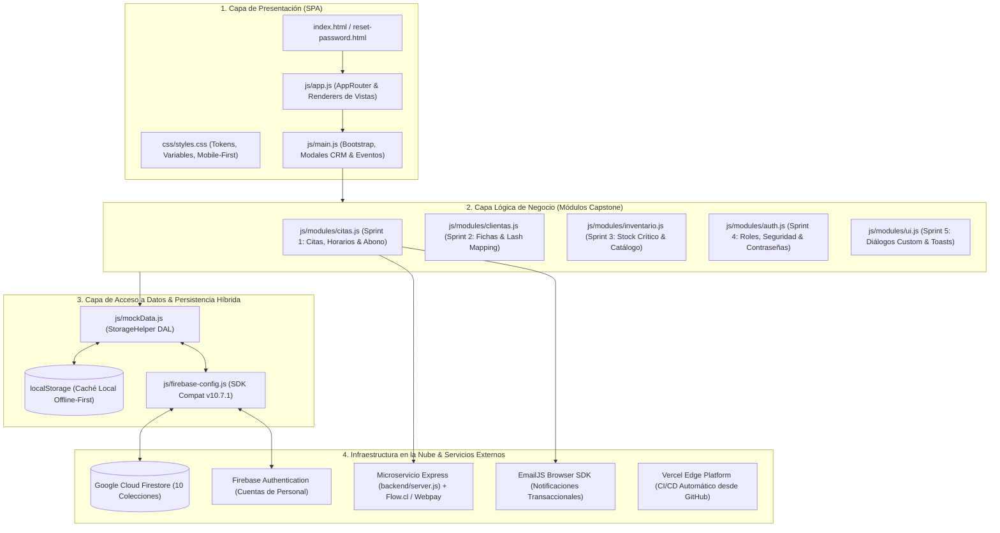

# 📑 INFORME TÉCNICO & HANDOFF DE INGENIERÍA
## Nicolett Studio Fantasy ✨ • Plataforma Web Integral
### Capstone Proyecto de Título APT 2026 • Duoc UC • Grupo 9

---

## 👥 1. Datos del Proyecto y Equipo

| Parámetro | Detalle Oficial |
|---|---|
| **Proyecto** | Nicolett Studio Fantasy - Digitalización Integral y Gestión Operativa |
| **Cliente / Beneficiario** | Nicolett Studio Fantasy (Avenida Bernardo O'Higgins 979, Buin, Región Metropolitana) |
| **Institución** | Duoc UC • Escuela de Informática y Telecomunicaciones |
| **Asignatura / Sección** | Capstone (APT) • Sección 003-D |
| **Docente Guía** | Paz Constanza Morales Saavedra |
| **Scrum Master & Frontend** | **José Cueto Moreira** (Arquitectura UI/UX, SPA Vanilla, CSS Mobile-First, Control de Calidad) |
| **Product Owner & Backend** | **Benjamín Moya Meza** (Arquitectura Cloud, Firebase Firestore, Firebase Auth, API Flow) |
| **URL Producción** | [https://nicolette-studio.vercel.app](https://nicolette-studio.vercel.app) |
| **Repositorio GitHub** | [https://github.com/jcueto001/Nicolette_studio](https://github.com/jcueto001/Nicolette_studio) (Rama principal: `main`) |
| **Estado General** | **100% Operativo y Desplegado en Producción (Sprints 1 al 5 Completados)** |

---

## 🏗️ 2. Arquitectura de Software y Desarrollo Realizado

El sistema implementa una **Arquitectura en Capas Desacoplada (Clean Architecture)** basada en Vanilla JavaScript modular moderno (ES6+), sin sobrecargas de frameworks pesados (React, Angular o Vue), garantizando máxima velocidad de carga (Lighthouse > 85 pts), bajo consumo de recursos en smartphones y compatibilidad offline-first.



### Detalle de Módulos Desarrollados:

#### 1. Módulo de Citas y Agendamiento (`js/modules/citas.js` - Sprint 1)
- **Horario Regular:** Franjas de 09:00 a 17:00 hrs.
- **Sobrecupos Flexibles:** Franjas extendidas de 18:00 a 21:00 hrs para clientas con turnos rotativos.
- **Filtrado por Profesional:** Evita traslape de turnos de una misma trabajadora.
- **Abono Obligatorio:** Regla de negocio de \$5.000 CLP de seña para asegurar el cupo.
- **Integración Transaccional:** Conexión con EmailJS para comprobantes de asistencia automáticos.

#### 2. Módulo de Clientas y Fichas Técnicas (`js/modules/clientas.js` - Sprint 2)
- **Bitácora Cronológica:** Expediente clínico y de belleza histórico por clienta.
- **Lash Mapping Técnico (RF-08):** Matriz especializada para extensiones de pestañas:
  - *Longitudes estándar:* 9mm, 10mm, 11mm, 12mm, 13mm.
  - *Curvaturas certificadas:* C, CC, D, DD, L, M.
  - *Grosores de fibra:* 0.05, 0.07, 0.10, 0.15, 0.20.

#### 3. Módulo de Inventario y Catálogo (`js/modules/inventario.js` - Sprint 3)
- **Control de Insumos (RF-10):** Registro de existencias en tiempo real sincronizado con Firestore.
- **Alerta de Stock Crítico:** Disparador visual preventivo cuando las existencias son $\le 5$ unidades.
- **Rebaja Automática:** Descuento programático de inventario al consolidar una ficha de atención.
- **Catálogo Informativo (RF-09):** Muestra a las clientas las marcas profesionales y certificaciones de los insumos aplicados (Cruelty-Free, Hipoalergénico, 9-Free).

#### 4. Módulo de Autenticación, Roles y Seguridad (`js/modules/auth.js` - Sprint 4)
- **Control de Acceso Basado en Roles (RBAC):**
  - `admin`: Acceso completo (Agenda, Fichas, Inventario, Gestión de Trabajadoras, Métricas y Reportes).
  - `profesional`: Acceso restringido a su agenda asignada, sus fichas técnicas y subida de fotos a galería.
- **Restablecimiento Seguro:** Portal dedicado [reset-password.html](file:///c:/Users/Usuario/Nicolette_studio/reset-password.html) integrado con Firebase Auth (`verifyPasswordResetCode`, `confirmPasswordReset`).
- **Tolerancia a Fallos:** Fallback de verificación offline mediante `StorageHelper.verifyStaffPassword()` si se interrumpe la red.

#### 5. Módulo de Interfaz y Experiencia de Usuario (`js/modules/ui.js` - Sprint 5)
- **Diálogos Personalizados:** Sustitución de `window.alert()` y `window.confirm()` nativos por modales elegantes con estética corporativa (oro rosa, nude y marfil).
- **Notificaciones Toast:** Alertas no bloqueantes auto-temporizadas.
- **Responsive Mobile-First:** Optimización para pantallas de teléfonos (360px a 480px) y tablets.

#### 6. Microservicio Backend de Pagos (`backend/server.js`)
- **Tecnología:** Node.js con Express, CORS y Crypto.
- **Integración Flow.cl:** Generación de órdenes de pago seguras mediante firma de parámetros **HMAC-SHA256**.
- **Endpoints Clave:**
  - `GET /api/flow/config`: Estado de conexión con pasarela y modo Sandbox/Producción.
  - `POST /api/flow/create`: Creación de orden de abono (\$5.000) y redirección a Webpay Plus/CuentaRUT.
  - `POST /api/flow/notify`: Webhook seguro que recibe la confirmación asíncrona de Flow.
  - `POST /api/flow/status` / `GET /api/flow/status`: Consulta del estado final de la transacción.

---

## 📊 3. Matriz de Requerimientos y Cumplimiento (Anexo 5 Capstone)

| ID | Requerimiento | Tipo | Sprint | Estado | Archivo de Implementación |
|---|---|---|:---:|:---:|---|
| **RF-01** | Inicio de sesión con autenticación y perfiles | Funcional | Sprint 4 | **Completado (100%)** | [js/modules/auth.js](file:///c:/Users/Usuario/Nicolette_studio/js/modules/auth.js) |
| **RF-02** | Gestión y asignación de trabajadoras/roles | Funcional | Sprint 4 | **Completado (100%)** | [js/modules/auth.js](file:///c:/Users/Usuario/Nicolette_studio/js/modules/auth.js), [js/app.js](file:///c:/Users/Usuario/Nicolette_studio/js/app.js) |
| **RF-03** | Agendamiento de citas con horarios y sobrecupos | Funcional | Sprint 1 | **Completado (100%)** | [js/modules/citas.js](file:///c:/Users/Usuario/Nicolette_studio/js/modules/citas.js), [js/app.js](file:///c:/Users/Usuario/Nicolette_studio/js/app.js) |
| **RF-04** | Agenda individual diferenciada por trabajadora | Funcional | Sprint 1 | **Completado (100%)** | [js/modules/citas.js](file:///c:/Users/Usuario/Nicolette_studio/js/modules/citas.js) |
| **RF-05** | Cobro de abono de \$5.000 vía pasarela de pago | Funcional | Sprint 1 | **Completado (100%)** | [backend/server.js](file:///c:/Users/Usuario/Nicolette_studio/backend/server.js), [js/main.js](file:///c:/Users/Usuario/Nicolette_studio/js/main.js) |
| **RF-06** | Envío de confirmaciones automáticas por correo | Funcional | Sprint 1 | **Completado (100%)** | [js/modules/citas.js](file:///c:/Users/Usuario/Nicolette_studio/js/modules/citas.js) (EmailJS) |
| **RF-07** | Ficha técnica de clienta y bitácora histórica | Funcional | Sprint 2 | **Completado (100%)** | [js/modules/clientas.js](file:///c:/Users/Usuario/Nicolette_studio/js/modules/clientas.js), [js/app.js](file:///c:/Users/Usuario/Nicolette_studio/js/app.js) |
| **RF-08** | Campos técnicos dinámicos y Lash Mapping (9-13mm) | Funcional | Sprint 2 | **Completado (100%)** | [js/modules/clientas.js](file:///c:/Users/Usuario/Nicolette_studio/js/modules/clientas.js) |
| **RF-09** | Catálogo informativo de productos del salón | Funcional | Sprint 3 | **Completado (100%)** | [js/modules/inventario.js](file:///c:/Users/Usuario/Nicolette_studio/js/modules/inventario.js), [js/app.js](file:///c:/Users/Usuario/Nicolette_studio/js/app.js) |
| **RF-10** | Control de stock de insumos y alerta crítica ($\le 5$) | Funcional | Sprint 3 | **Completado (100%)** | [js/modules/inventario.js](file:///c:/Users/Usuario/Nicolette_studio/js/modules/inventario.js) |
| **RNF-01**| Identidad visual de lujo (Rose Gold, Nude, Marfil) | No Func. | Sprint 5 | **Completado (100%)** | [css/styles.css](file:///c:/Users/Usuario/Nicolette_studio/css/styles.css) |
| **RNF-02**| Diseño Responsive Mobile-First (360px a 1440px) | No Func. | Sprint 5 | **Completado (100%)** | [css/styles.css](file:///c:/Users/Usuario/Nicolette_studio/css/styles.css) |
| **RNF-03**| Rendimiento y carga rápida (Lighthouse > 85) | No Func. | Transversal | **Completado (100%)** | Vanilla JS sin frameworks pesados |
| **RNF-04**| Reglas de seguridad en base de datos Firestore | No Func. | Sprint 4 | **Completado (100%)** | `firestore.rules` documentadas |
| **RNF-05**| Cifrado de conexiones bajo protocolo HTTPS/TLS | No Func. | Transversal | **Completado (100%)** | Despliegue con SSL forzado en Vercel |

---

## 📜 4. Bitácora Cronológica de Cambios (Changelog de Versiones)

* **Versión v=1 a v=20:** Maquetación inicial de la Single Page Application (SPA), catálogo de servicios, galería fotográfica, integración con WhatsApp flotante y diseño del sistema de reserva flexible.
* **Versión v=21 a v=25:**
  - Integración del backend de pagos Flow.cl en Node.js con pasarela Webpay Plus.
  - Implementación del sistema de fichas técnicas para clientas y deducción de insumos de inventario.
  - Creación del portal administrativo de gestión de agenda y finanzas.
* **Versión v=26:**
  - Optimización responsiva de la sección "Sobre Nosotros" y ajuste de proporciones de imagen en móviles (`aspect-ratio: 16/10`, ocultamiento de marcos decorativos desfasados en pantallas < 768px).
* **Versión v=27:**
  - Solución del error `auth/unauthorized-continue-uri` de Firebase Auth implementando ActionCodeSettings adaptables y fallback seguro directo.
  - Creación del portal independiente y branded [reset-password.html](file:///c:/Users/Usuario/Nicolette_studio/reset-password.html).
  - Implementación de la **Arquitectura Modular por Sprints** (`js/modules/citas.js`, `clientas.js`, `inventario.js`, `auth.js`, `ui.js`) alineada estrictamente al Informe de Capstone de Duoc UC.
* **Versión v=28:**
  - **Migración total de datos estáticos a Cloud Firestore:** Seeding de 61 servicios, 10 categorías y 4 perfiles a colecciones oficiales de Firebase.
  - Implementación de sincronización dinámica en vivo y persistencia de respaldo en `localStorage`.
* **Versión v=29:**
  - **Limpieza masiva y optimización:** Eliminación de más de 730 líneas de datos estáticos quemados en [js/mockData.js](file:///c:/Users/Usuario/Nicolette_studio/js/mockData.js) (reducción del 40% del archivo).
  - Vinculación del primer Favicon enlazado en `index.html`.
* **Versión v=30 (Actual):**
  - **Actualización de Favicon Oficial en Alta Resolución:** Carga del isotipo oficial de Nicolett Studio de 952x952 px en [img/favicon.png](file:///c:/Users/Usuario/Nicolette_studio/img/favicon.png).
  - Incremento general de cache busters a `?v=30` en todos los archivos de estilos y scripts para invalidación forzada de caché de navegadores.

---

## 🔮 5. Mejoras Pendientes y Trabajo Futuro (Roadmap de Ingeniería)

Aunque los 5 Sprints y requerimientos del informe están 100% terminados, se proponen las siguientes mejoras evolutivas para futuras entregas o post-título:

1. **Transformación a PWA (Progressive Web App):**
   - Incorporar `manifest.json` y un `service-worker.js` para permitir la instalación de Nicolett Studio Fantasy como aplicación móvil nativa en teléfonos Android y iPhone de las clientas, permitiendo acceso directo desde la pantalla de inicio.
2. **Notificaciones Push Web (Firebase Cloud Messaging - FCM):**
   - Enviar recordatorios automáticos al celular de la clienta 24 horas y 2 horas antes de su cita, disminuyendo la tasa de inasistencia (*no-show*).
3. **Exportación Contable en Formato Excel y PDF:**
   - Incorporar en el panel administrativo la descarga directa de balances mensuales, totales de abonos percibidos y cierres de caja en archivos `.xlsx` y reportes en `.pdf` listos para contabilidad.
4. **Pasarela de Pago Secundaria Transbank SDK Directa:**
   - Habilitar como opción complementaria a Flow el cobro directo mediante la librería `transbank-sdk` para tarjetas de débito/crédito nacionales.

---

## 💡 6. Guía Operativa, Tips de Desarrollo y Despliegue

### ⚙️ Flujo de Despliegue Continuo (CI/CD con Vercel)
- El repositorio está conectado a **Vercel** mediante webhook directo a la rama `main`.
- **Regla de oro:** Cada vez que se hace un `git push origin main`, Vercel detecta el cambio e inicia el despliegue automático en la nube, estando disponible en **https://nicolette-studio.vercel.app** en aproximadamente 15 a 20 segundos.
- No es necesario ejecutar compiladores pesados ni comandos manuales de deploy.

### 🔄 Técnica de "Cache Busting" (¿Por qué usamos `?v=XX`?)
- Los navegadores web guardan en caché los archivos `.css` y `.js` para no descargarlos repetidamente.
- Cuando modifiques código en `styles.css` o en los archivos `.js`, **debes incrementar el parámetro de versión** en [index.html](file:///c:/Users/Usuario/Nicolette_studio/index.html) (ejemplo: cambiar `?v=30` a `?v=31`).
- Esto obliga al navegador de todos los usuarios (y al del profesor al evaluar) a descargar el código nuevo inmediatamente sin tener que pedirles que borren su historial.

### 💻 Tips de Terminal en Windows PowerShell
- **Problema conocido con `&&`:** En PowerShell 5.1 (el estándar de Windows), el operador `&&` no existe y arroja el error:
  `El token '&&' no es un separador de instrucciones válido en esta versión.`
- **Solución:** Encadenar siempre los comandos con punto y coma (`;`):
  ```powershell
  git add -A; git commit -m "mensaje descriptivo"; git push origin main
  ```

### 🧪 Comprobación de Sintaxis Previa a Commits
Antes de subir cambios que puedan romper la interfaz, ejecuta una validación rápida con Node.js en la terminal:
```powershell
node --check js/mockData.js; node --check js/app.js; node --check js/main.js
```
Si el comando no emite texto y retorna código 0, la sintaxis es 100% limpia y segura para desplegar.

